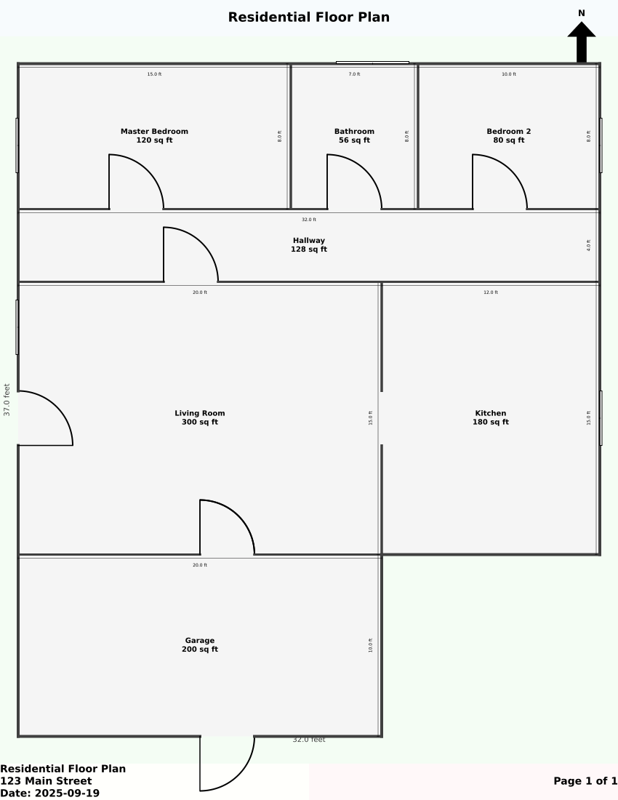
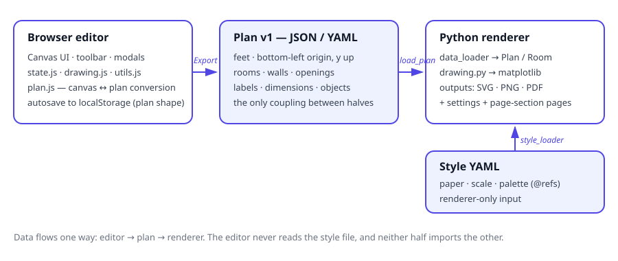

# floorplan-studio

[](https://github.com/enonymous1/floorplan-studio/actions/workflows/ci.yml)
[](LICENSE)

Draw a floor plan in the browser, then render it as a print-ready
page. One repo, two halves, one shared plan format: the editor is
for drawing, the renderer is for printing, and the plan file is the
only coupling between them.

<!--
  HERO IMAGE (to capture, not yet in the repo):
  docs/assets/editor-hero.png — a real screenshot of the editor with
  examples/floor_plan.json imported, the sample plan on the canvas,
  toolbar visible, "Show Dimensions" on. 1600x900 or larger.
  Place the live  tag here, directly under the description,
  once the file exists:
  
-->

## Description

`floorplan-studio` pairs two tools that were originally separate
projects:

- **`editor/`** — an interactive Canvas editor (walls, rooms,
  doors, windows, labels, dimensions, stairs, roads) with
  undo/redo, pan/zoom, and 20 px/ft grid snapping. It runs with
  no build step and exports the shared plan format as JSON or
  YAML.
- **`renderer/`** — a Python CLI that turns a plan (YAML or
  JSON) into a scaled SVG, PNG, or PDF page with a title block,
  dimensions, and a north arrow.

The workflow the project exists for: draw in the editor,
**Export JSON/YAML**, then render:

```powershell
floorplan render floor-plan.json --output-dir output
```

That produces `floor_plan.<format>` plus a settings page and a
page-section diagram in the same directory.

The plan format (version 1) is feet, origin bottom-left, y
increasing upwards. Rooms are `[x, y, width, height]`; doors and
windows are axis-aligned `pos: [[x1, y1], [x2, y2]]` segments
with an optional `swing` of `"in"` or `"out"`. See
[Plan format](#plan-format) for the full shape.

## Prerequisites

- **Renderer:** Python 3.10 or newer, plus `pip`. The renderer
  depends on `matplotlib >= 3.8` and `PyYAML >= 6.0`; both are
  installed automatically by the install step below.
- **Editor (to run it):** any modern browser and a static file
  server. Python's built-in server is enough; no Node.js is
  needed just to open the editor, because the built Tailwind
  CSS is committed in `editor/dist/styles.css`.
- **Editor (to develop it):** Node.js 20 or newer and `npm`
  (for tests, the syntax check, and rebuilding the CSS).
- **To contribute:** Git, and the test commands in
  [Local Development](#local-development).

## Installation

### Renderer

From the repo root:

```powershell
pip install -e renderer
```

This installs the distribution `floorplan-studio` and provides
the `floorplan` command (the import package is also named
`floorplan`, so `python -m floorplan` works the same way).
Verify it:

```powershell
floorplan --version
floorplan render examples/floor_plan.yaml --output-dir output
```

For development, install with the dev extras instead:

```powershell
pip install -e "renderer[dev]"
```

### Editor

There is nothing to install to run it. Serve the folder and
open it in a browser:

```powershell
cd editor
python -m http.server 8000
# open http://localhost:8000
```

If you change `editor/src/tailwind.css`, rebuild the committed
CSS (see [Local Development](#local-development)) — a fresh
clone renders styled only because `dist/styles.css` is
committed, and CI fails if it goes stale.

## Usage

### Drawing a plan

Open the editor and pick a tool from the left toolbar: Select
(V), Wall (W), Room (R), Door (D), Window (I), Object library
(O, stairs and roads), Label (T), Dimension (M), Eraser (E).
Drag on the canvas to draw; the footer shows the cursor
position in feet and the zoom level. Middle-drag (or Ctrl-drag)
pans; the mouse wheel zooms toward the cursor.

- **Select** moves and resizes objects. Clicking a selected
  door toggles its hinge end or swing direction. Double-click
  a label or road to rename it; double-click a dimension
  (with "Show Dimensions" on) to edit its value.
- **Plan section** (bottom of the toolbar): **Export JSON**,
  **Export YAML**, and **Import JSON**. Work is also autosaved
  to the browser's local storage as a plan, so a refresh
  restores the canvas. **Clear** empties the canvas and is
  undoable with Undo (Ctrl+Z) / Redo (Ctrl+Y).

<!--
  WORKFLOW GIF (to capture, not yet in the repo):
  docs/assets/draw-export-render.gif — a real screen recording,
  ~15-20 seconds, looped: draw a room in the editor, Export JSON,
  run `floorplan render` in a terminal, open the resulting SVG.
  Place the live  tag here, at the end of the Usage section,
  once the file exists:
  
-->

### Rendering a plan

```powershell
floorplan render examples/floor_plan.yaml --output-dir output
floorplan render examples/floor_plan.json --format png --output-dir output
floorplan convert examples/floor_plan.yaml floor-plan.json
```

`floorplan render` writes three files to the output directory
(created when missing): `floor_plan.<format>`,
`floor_plan_settings.<format>`, and
`floor_plan_page_sections.<format>`. Options: `--style` (a
style YAML; otherwise the bundled style is used),
`--format svg|png|pdf`, `--title`, `--address`, `--date`.
Precedence is CLI flags, then plan metadata, then the style
file.

Convert between formats with `floorplan convert`; the output
format is chosen by the file suffix (`.yaml`/`.yml`/`.json`).

### Example output

The image below is the real output of the renderer on
`examples/floor_plan.yaml` — not a mockup:



### Plan format

Plans are JSON or YAML with the same shape. Only `rooms` is
required (it may be empty). All coordinates are feet, origin
bottom-left, y increasing upwards — the opposite vertical
direction from the editor canvas, which is flipped at the
editor boundary in `editor/modules/plan.js` (20 px/ft, lossless
both ways; the renderer centres the plan on the page, so
exported y values being negative is fine).

```json
{
  "version": 1,
  "title": "Residential Floor Plan",
  "address": "123 Main Street",
  "date": "2025-09-19",
  "boundary": [[0, 0], [32, 0], [32, 27], [0, 27]],
  "rooms": [
    {
      "name": "Living Room",
      "rect": [0, 0, 20, 15],
      "doors": [{ "pos": [[10, 0], [13, 0]], "swing": "in" }],
      "windows": [{ "pos": [[2, 15], [8, 15]] }]
    }
  ]
}
```

Optional sections: `walls` (standalone segments), `openings`
(door/window segments that lie on no room edge),
`labels` (`text`, `point`, `rotation`), `dimensions`
(`pos`, `label`), and `objects` (`kind: stairs|road`,
`rect`, `label`). A door/window segment lying on a room edge
attaches to the first such room (within 0.01 ft), so the
renderer cuts a door gap in that wall; segments on no room
edge stay as `openings`. Editor-only door fields
(`swingDirection`, `hingeAtStart`) ride along under an
`editor` key and are restored on import; the renderer ignores
them. A plan's `boundary` has no canvas object in the editor:
it is preserved on import and re-exported unchanged, and the
renderer uses it for exterior-wall checks.

The sample in `examples/floor_plan.yaml` and its JSON twin
`examples/floor_plan.json` show every section in use except
`objects`. Style lives separately in
`examples/floor_plan_style.yaml` (also bundled with the
renderer): paper size, scale, palette with `@key` references,
line/text styles, and dimension/window/door settings. The
address and date in the sample style are fictional example
data.

## Architecture



The data flow is one-directional and deliberately boring:
canvas objects → `editor/modules/plan.js` → plan v1
(JSON/YAML) → `renderer` loader → `Plan`/`Room` →
matplotlib page. The style file is a second, independent
input to the renderer only; the editor never reads it.
Neither half imports or calls the other, so either half can
be replaced (a new editor, a second renderer backend) as long
as it speaks plan v1. The format's validation lives in both
halves today (`data_loader.py` and `plan.js: validatePlan`);
a JSON Schema contract is the recommended single source of
truth for the format's shape, with the hand-written validators
keeping only the semantic rules (axis-alignment, positive
sizes).

```text
editor/                 Browser editor (ES modules, Tailwind 3)
  index.html            Toolbar, canvas, modals, import/export controls
  script.js             Event handling, history, persistence, import/export
  modules/state.js      Shared mutable state
  modules/drawing.js    Canvas rendering
  modules/utils.js      Snapping, hit-testing, handles
  modules/plan.js       Shared-format conversion + YAML serializer (pure, tested)
  src/tailwind.css      Tailwind source
  dist/styles.css       Built CSS, committed so a fresh clone works
  tests/plan.test.mjs   Conversion, attachment, round-trip, YAML tests
renderer/               Python package (matplotlib + PyYAML)
  src/floorplan/        cli, data_loader, style_loader, drawing, room, models
  tests/                Loader, rendering, CLI tests
examples/               Sample plan (YAML + JSON) and style file
docs/demo.svg           Real renderer output on the sample plan
```

## Local Development

### Renderer

```powershell
cd renderer
pip install -e ".[dev]"
ruff check src tests
pytest
```

Run the sample render from the repo root to check your
changes end to end:

```powershell
floorplan render examples/floor_plan.yaml --output-dir output
floorplan render examples/floor_plan.json --format png --output-dir output
```

To validate a plan against the format contract
(`schema/plan-v1.json`, enforced in CI — needs the
`jsonschema` package, which is not a renderer runtime
dependency):

```powershell
python scripts/check-schema.py examples/floor_plan.yaml examples/floor_plan.json
```

To check the JSON twin still matches the YAML (it is
described as generated, so keep it honest):

```powershell
floorplan convert examples/floor_plan.yaml /tmp/check.json
diff /tmp/check.json examples/floor_plan.json
```

### Editor

```powershell
cd editor
npm install
npm test
npm run check
npm run build:css
git diff --exit-code dist/styles.css
```

`npm test` runs the `plan.js` tests (conversion, attachment,
round-trip, YAML). `npm run check` parses every editor script
as an ES module without executing it. The last two commands
are the CSS-freshness gate: after changing
`src/tailwind.css`, rebuild and commit `dist/styles.css`,
or CI fails. Serve with `python -m http.server 8000` and
check canvas behaviour in a browser — canvas interaction is
not covered by automated tests yet (see Known limits).

### Before submitting a change

Run the full gates from a fresh extraction, not just
in-place: `pytest`, `ruff check renderer/src
renderer/tests`, `npm test`, `npm run check`, the CSS
freshness diff, and a CLI render of both example files.
Keep the export's existing habit: a gate that only passes
in your working tree has not passed.

## Deployment

No release automation exists yet; the steps below are the
manual process, and a tag-triggered workflow (tests → build →
publish/deploy) is the recommended next automation.

### Editor to GitHub Pages (static site)

The editor is fully static: `index.html`, `script.js`,
`modules/`, and `dist/styles.css`, with all asset and module
paths relative, so it works under a Pages subpath
(`https://<user>.github.io/floorplan-studio/`) as well as at
a domain root. The one external dependency is the Inter font
from Google Fonts; the page falls back to the system
sans-serif font offline.

GitHub Pages' branch publishing only offers the repo root
or `/docs`, so the editor (in `editor/`) is deployed with a
GitHub Actions workflow, not a branch setting. Add
`.github/workflows/pages.yml`:

```yaml
name: Pages
on:
  push:
    branches: [main]
    paths: ['editor/**']
permissions:
  contents: read
  pages: write
  id-token: write
concurrency:
  group: pages
  cancel-in-progress: true
jobs:
  deploy:
    runs-on: ubuntu-latest
    environment:
      name: github-pages
      url: ${{ steps.deployment.outputs.page_url }}
    steps:
      - uses: actions/checkout@v4
      - uses: actions/configure-pages@v5
      - uses: actions/upload-pages-artifact@v3
        with:
          path: editor
      - uses: actions/deploy-pages@v4
        id: deployment
```

Then, in the repo, go to Settings → Pages → Build and
deployment → Source: GitHub Actions. Open the published
URL, draw a room, and Export JSON to smoke-test the
deployment — the editor has no server component, so a
successful page load plus one export is the whole check.
Keep the workflow's path filter scoped to `editor/**` so
renderer-only changes do not redeploy the site.

### Renderer to PyPI

The distribution name is `floorplan-studio`; the installed
command and import package remain `floorplan`.

```powershell
cd renderer
python -m pip install --upgrade build twine
python -m build
python -m twine upload dist/*
```

Verify the published package in a clean environment before
announcing it:

```powershell
pip install floorplan-studio
floorplan --version
floorplan render examples/floor_plan.yaml --output-dir output
```

Note: `examples/floor_plan.yaml` is not shipped in the
package, so the verify step above needs a checkout (or any
plan file) alongside the install. A release checklist that
includes the clean-environment install, the sample render,
and a GitHub Release with the changelog entry is worth more
than the publish command itself.

### Versioning

Releases follow the version in `renderer/pyproject.toml`
and `editor/package.json`, which are currently kept in sync
by hand (see the staff review for the single-source fix).
Tag a release as `vX.Y.Z` after merging, and keep
`CHANGELOG.md` updated in the same change — the changelog
is the release notes' source of truth.

## Known limits

- Windows are only drawn when they lie on an exterior wall
  (or, with no boundary, on a room wall). Interior windows
  in the data are skipped by design, matching the original
  renderer.
- Diagonal door/window segments are rejected by the loader;
  walls may be diagonal.
- Stairs and roads render as labelled rectangles, not as
  the editor's stepped/road drawing.
- The editor imports JSON only. A YAML export can be
  converted back to JSON with
  `floorplan convert plan.yaml plan.json` and then imported.
- A plan larger than the page at the style's scale is
  centred and clipped, not fitted to the page; there is no
  fit-to-page option yet.
- The editor's canvas interaction (dragging, resizing,
  modal flows) was verified by syntax and plan-logic tests,
  not by driving a browser; try it in a browser before
  relying on a new interaction.

## Contributing

Issues and pull requests are welcome. Please run the gates
in [Local Development](#local-development) before submitting,
keep the plan format backward-compatible (or propose the
version bump and migration together), and do not rewrite one
half in the other's language — the two-stack design is
intentional. If you change the editor's CSS source, commit
the rebuilt `dist/styles.css` in the same change.

## License

MIT — see [LICENSE](LICENSE).

## History

Version 2.0.0 merges two February 2026 projects — the Python
renderer (`ss-floorplan`) and the browser editor
(`ss-floor_plan_creator`) — into this single repo,
`floorplan-studio`, under a shared plan format, keeping both
stacks. This is a squashed export: the earlier single-commit
histories under a student identity are intentionally not
included. Version 2.1.0 applies the staff-review fixes:
style validation with clean CLI errors, a shared
editor/renderer wall tolerance, a bounded undo history,
the plan-format JSON Schema with a CI contract job, and the
version single-sourced from `pyproject.toml`. Version
2.1.1 fixes the sample render: doors draw as a leaf plus a
full quarter-circle arc, the north-arrow "N" sits above the
arrow tip, and the sample plan no longer has a Hallway
duplicating the Bathroom or a Garage outside the boundary.
Version 2.2.0 rebuilds the sample's circulation (a real
Hallway, a front door, an open Living-Kitchen passage)
and adds `swing: "none"` for passageways. Version 2.2.1
replaces that full-width hallway with the typical
small-house pattern: open living/kitchen south, a short
central hall in the bedroom wing north. Version 2.2.2
rebuilds the sample again, after a published
split-bedroom ranch (Houseplans 430-10) rather than an
invented tiling: a 22 x 20 ft garage with a 16 ft double
door, mudroom garage entry, great room with a street-side
front door, kitchen/dining open at the rear, a primary
suite (bedroom, closet, bath) in the west wing, and a
single-loaded hall serving the east bedrooms — drawn at
1/8" on a landscape sheet so the 74 ft house fits its
page. See [CHANGELOG.md](CHANGELOG.md) for what changed
and what was removed.
